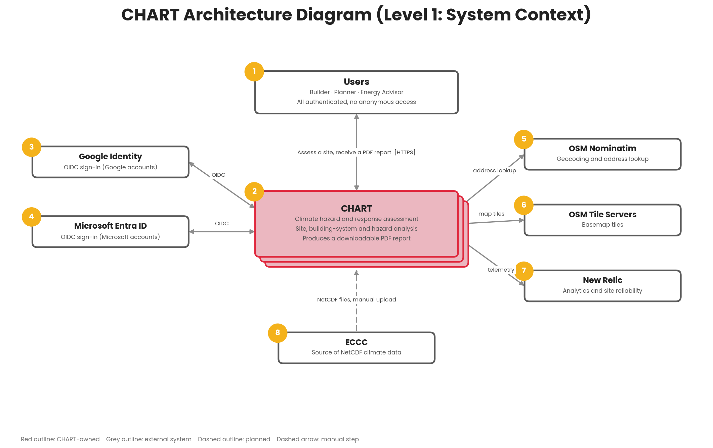
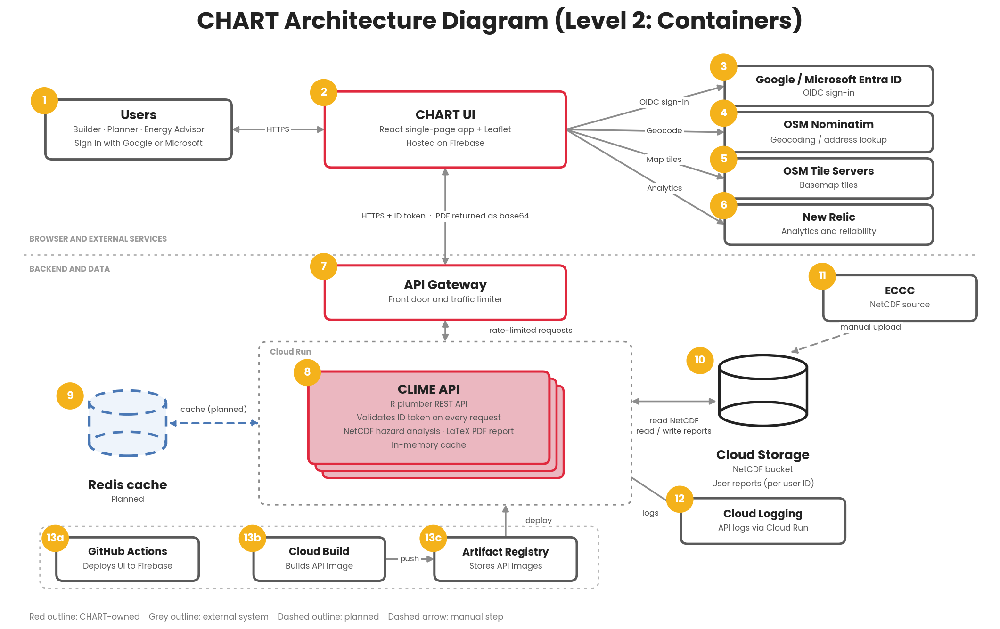

# CHART Architecture

This document maps the architecture for the CHART tool.

## Purpose

`chart-ui` is the React frontend for the CHART tool. It collects building, site, and intake data; guides the user through a multi-step flow; requests analysis and reports from `clime-api`; and displays saved reports.

## Architecture Diagrams

### Level 1: System Context

1. Users: Builders, planners, and energy advisors. They sign in, describe a site (location, building systems, site features), and receive a PDF report on climate hazards.
2. CHART: The system as a whole, shown as one box at this level. It assesses climate hazards and possible faults for a site and produces the report.
3. Google Identity: Signs users in with their Google account using OIDC.
4. Microsoft Entra ID: Signs users in with their Microsoft account using OIDC.
5. OSM Nominatim: Turns the address a user types into coordinates (geocoding and address lookup).
6. OSM Tile Servers: Supply the basemap tiles for the map.
7. New Relic: Receives analytics and site reliability data from the app.
8. ECCC: Environment and Climate Change Canada, the source of the NetCDF climate data.

### Level 2: Containers

Level 2: Containers

1. Users: Same users as Level 1. They reach CHART through their browser over HTTPS and sign in with a Google or Microsoft account.
2. CHART UI: The React single-page app, with Leaflet for maps, hosted on Firebase. It runs the sign-in flow, collects the site details, shows the map, calls the API with the user’s ID token, and lets the user download the PDF.
3. Google / Microsoft Entra ID: The two identity providers. The UI redirects users to them for OIDC sign-in and gets back an ID token.
4. OSM Nominatim: Called directly from the UI to look up and geocode addresses.
5. OSM Tile Servers: Called directly from the UI to load basemap tiles for Leaflet.
6. New Relic: Receives analytics and reliability telemetry from the UI.
7. API Gateway: The front door for the backend. It receives the UI’s API calls and limits traffic before passing requests to the CLIME API.
8. CLIME API: The R plumber REST API running as a Docker image on Cloud Run. It validates the signed ID token on every request, analyzes hazards from the NetCDF data, builds the report as a PDF with LaTeX, and returns it as base64. It also keeps an in-memory cache.
9. Redis cache: A future cache to replace the in-memory one.
10. Cloud Storage: Holds two sets of data: the bucket of NetCDF files the API reads, and each user’s saved reports, stored under their user ID.
11. ECCC: The data source for NetCDF files. These are manually uploded into the Cloud Storage bucket.
12. Cloud Logging: Collects the API’s logs through the default Cloud Run integration.
13. a. GitHub Actions: Builds the UI and deploys it to Firebase.
14. b. Cloud Build: Builds the CLIME API Docker image.
15. c. Artifact Registry: Stores the API images, which are then deployed to Cloud Run.

A typical request: The user opens the UI (2), signs in through the identity provider (3), and types an address, which Nominatim (4) resolves. The UI sends the site details with the ID token through API Gateway (7) to the CLIME API (8). The API checks the token, reads the NetCDF data from Cloud Storage (10), generates the PDF, saves a copy under the user’s ID, and returns it to the UI.

## Application Entry and Routing

- `src/main.tsx` creates the Redux store and persistence layer, initializes Microsoft MSAL, configures providers, and registers the browser router.
- `src/App.tsx` provides the application shell and route outlet.
- Routes are defined in `src/main.tsx` for the splash screen, design flow, chart flow, saved reports, and fallback navigation.
- `src/pages/` contains route-level components.

## Feature Organization

- `src/components/Chart/` contains the stepper flow, step rendering, cards, and chart-specific interactions.
- `src/components/Auth/` contains Google and Microsoft OIDC flows.
- `src/components/Map/` and `src/utils/geocode.ts` support location selection and geocoding.
- `src/components/TestMode/` contains test-mode behavior and context.
- `src/components/ui/` contains reusable UI primitives.
- `src/i18n/` contains locale state, dictionaries, translation, and formatting helpers.
- `src/hooks/` contains reusable flow, media, and idle-timeout behavior.

## State and Data Flow

- Redux Toolkit owns application state under `src/state/`.
- `redux-persist` stores selected state in `sessionStorage`, so it survives reloads in the same tab session.
- `src/steps.ts` defines the chart workflow steps; page and feature components
  render the corresponding inputs and results. Users review their inputs on the
  report step and can jump directly back to intake, systems, or site features to
  edit them.
- API requests use the configured API host. Report generation and saved-report requests include authentication headers, while only some requests include the user-timezone header; reference-data requests do not include either.

## Authentication

- The frontend supports OIDC sign-in, but authentication is not required for every route: the splash screen is public, and the saved-reports page redirects users without a profile to the splash screen.
- Google sign-in is handled through `@react-oauth/google`.
- Microsoft sign-in is handled through MSAL and `@azure/msal-react`.
- The frontend sends the ID token and auth-provider identifier in the `X-ID-Token` and `X-Auth-Provider` request headers; the backend uses them for authenticated API access, including saved reports.
- Client IDs and API configuration are supplied through Vite environment variables; see the repository README and `docs/OIDC.md`.

## API and Hosting

- Vite is configured to proxy `/api/*` to the local API service, but current frontend API calls use `VITE_API_HOST` URLs directly; the README's local setup points that variable at `http://localhost:8080`.
- Production builds generate `dist/` and deploy through Firebase Hosting.
- `firebase.json` configures hosting and the `/api/**` rewrite toward the Cloud Run API service.
- The frontend calls report-generation, reference-data, and saved-report endpoints exposed by `clime-api`.

## Testing and Quality

- Vitest runs in jsdom with React Testing Library and co-located `__tests__/` directories.
- Accessibility checks use axe tooling for applicable component states.

## Related Documentation

- [Project README](../README.md) for setup, scripts, CI, and deployment workflows
- [Hosting](HOSTING.md)
- [OIDC configuration](OIDC.md)
